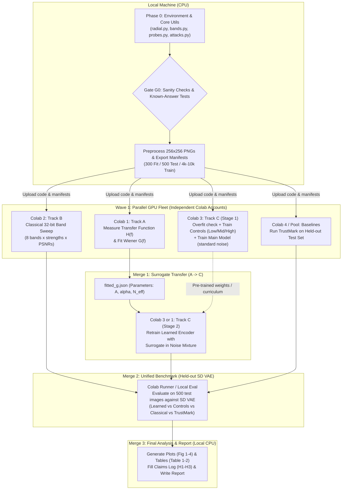

# Distributed Multi-Colab Execution Workflow
## Spectral Band Allocation for Invisible Watermarks Under VAE Regeneration

---

## 1. Executive Summary & Constraints Mapping

This workflow reorganises the research plan from the project guide to exploit **multiple Google Colab accounts (free or Pro) in parallel**, while keeping **CPU-heavy code generation, unit testing, manifest creation, and paper writing on the local machine**.

### Core Constraints & Optimisations
1. **Zero-GPU Idling**: Heavy GPU jobs (Track A VAE sweeps, Track B classical sweeps, Track C learned encoder training, TrustMark benchmarking) are decoupled so they run **concurrently across separate Colab instances** instead of sequentially.
2. **Strict File-Based Contracts**: Colab workers communicate exclusively through lightweight artifacts (`manifests.json`, `fitted_g.json`, tidy CSVs, and model `.pt` weights) synced via Google Drive or GitHub.
3. **Fail-Fast Gating (Gate G0)**: No long GPU runs are dispatched until local known-answer tests pass (orthonormal FFT radial profiles, probe energy conservation, and attack wrappers).

---

## 2. Multi-Account Colab Fleet Allocation

| Worker ID | Environment | Track / Task | Inputs | Outputs | Parallel Slot |
| :--- | :--- | :--- | :--- | :--- | :--- |
| **Local Host** | Local CPU | **Phase 0 + Track E**<br>Core utils, tests, Gate G0, manifests, writing | Raw COCO val/train subset | `data/manifests/`, `core/` unit tests, `report/` | Continuous |
| **Colab 1** | Colab Account 1 (T4/V100/A100) | **Track A: Measure & Fit**<br>Transfer function sweeps across CompressAI & SD VAE; Wiener fit | `fit_manifest.json`, `core/`, `track_a/` | `results/track_a_transfer.csv`, `fitted_g.json` | **Wave 1** (Immediate) |
| **Colab 2** | Colab Account 2 (T4/V100/A100) | **Track B: Classical Sweep**<br>32-bit spread-spectrum sweep (8 bands × strengths × 4 PSNRs) | `fit_manifest.json`, `core/`, `track_b/` | `results/track_b_sweep.csv` | **Wave 1** (Immediate) |
| **Colab 3** | Colab Account 3 (T4/V100/A100) | **Track C1: Stage-1 Training**<br>Sanity overfit + Controls (Low, Mid, High) + Baseline Main Model (without surrogate) | `train_manifest.json`, `core/`, `track_c/` | `checkpoints/c_baseline.pt`, `checkpoints/c_controls/` | **Wave 1** (Immediate) |
| **Colab 4** | Colab Account 4 (Optional / Or Colab 1 after Track A) | **Track D: Baselines**<br>TrustMark external reference watermark evaluation on held-out test images | `test_manifest.json`, `track_d/` | `results/trustmark_baseline.csv` | **Wave 1 / Wave 2** |
| **Colab 3 or 1** | Colab (Wave 2) | **Track C2: Stage-2 Surrogate Retrain**<br>Train Main Model with spectral-transfer surrogate loaded from Colab 1's `fitted_g.json` | `fitted_g.json`, `track_c/` | `checkpoints/c_surrogate_trained.pt` | **Wave 2** (After Merge 1) |
| **Any Free Colab** | Colab (Wave 3) | **Merge 2: Final Held-Out Evaluation**<br>Run all models (Learned, Controls, Classical, TrustMark) against SD VAE | All checkpoints, `test_manifest.json` | `results/merge2_final_eval.csv` | **Wave 3** (After Wave 2) |

---

## 3. Parallel Execution Graph & Merge Points



---

## 4. Shared Data Contracts (Inter-Worker Specifications)

Every worker operates strictly to these schemas, preventing pipeline breakages across Colabs:

### 4.1 Data Manifests (`data/manifests/`)
Single source of truth for splits. Images never overlap.
- `train_manifest.json`: Array of relative paths (4,000 to 10,000 images from COCO train/val).
- `fit_manifest.json`: Array of exactly 300 image paths (from COCO train/val, disjoint from test).
- `test_manifest.json`: Array of exactly 500 image paths (held-out COCO val2017).

### 4.2 Fitted-G JSON Contract (`results/fitted_g.json`)
Produced by Colab 1 (Track A), consumed by Colab 3 (Track C):
```json
{
  "attack_family": "compressai_bmshj2018",
  "dataset_alpha": 1.98,
  "dataset_log_A": 4.12,
  "strengths": {
    "q1": { "N_eff": 0.082, "fit_r2": 0.96, "f_c_pred": 0.095, "f_c_meas": 0.091 },
    "q4": { "N_eff": 0.021, "fit_r2": 0.98, "f_c_pred": 0.220, "f_c_meas": 0.215 },
    "q8": { "N_eff": 0.003, "fit_r2": 0.99, "f_c_pred": 0.410, "f_c_meas": 0.405 }
  },
  "sd_vae_sigma_scaling": {
    "sigma_sq": [0.001, 0.005, 0.01, 0.02],
    "N_eff": [0.0012, 0.0058, 0.0115, 0.023]
  }
}
```

### 4.3 Tidy Results CSV Schema (`results/*.csv`)
All sweeps (Track B, Track D, Merge 2) write to this exact tabular schema:
```csv
method,band,attack,strength,psnr_target,psnr_actual,image_id,bit_acc,lpips,ssim
```

---

## 5. Directory Structure & Repository Layout

```
project/
├── WORKFLOW.md                <-- This master plan & coordination guide
├── requirements.txt           <-- Core dependencies
├── data/
│   ├── manifests/             <-- train.json, fit.json, test.json
│   └── processed/             <-- 256x256 PNGs (fit: 300, test: 500)
├── core/
│   ├── __init__.py
│   ├── radial.py              <-- rfft2/fftshift, radial_profile(power2d, n_bins=32)
│   ├── bands.py               <-- band_masks(8 disjoint annuli over [0, 0.5])
│   ├── probes.py              <-- Band-limited probe generation & PSNR scaling
│   └── attacks.py             <-- CompressAI, SD-VAE, JPEG, Gaussian noise, blur
├── track_a/
│   ├── measure.py             <-- Transfer function sweep H(band)
│   └── fit.py                 <-- Fit 1/f^alpha image power and Wiener G(f) -> fitted_g.json
├── track_b/
│   ├── watermark.py           <-- 32-bit classical spread-spectrum embedder/decoder
│   └── sweep.py               <-- 8 bands x strengths x PSNR grid runner
├── track_c/
│   ├── model.py               <-- Encoder, Decoder, Band-Allocation Layer (learnable theta)
│   ├── noise_layers.py        <-- Differentiable noise + Spectral-transfer surrogate G
│   └── train.py               <-- Curriculum trainer, controls (low/mid/high), logging
├── track_d/
│   ├── metrics.py             <-- PSNR, SSIM, LPIPS, bit accuracy, binomial TPR@FPR
│   ├── harness.py             <-- Unified benchmarking runner (supports any watermarker)
│   └── plots.py               <-- Fig 1, Fig 2, Fig 3, Fig 4 from results CSVs
├── colab/                     <-- Self-contained headless entrypoint notebooks/scripts
│   ├── colab_worker_a.ipynb   <-- Run Track A on Colab 1
│   ├── colab_worker_b.ipynb   <-- Run Track B on Colab 2
│   ├── colab_worker_c.ipynb   <-- Run Track C on Colab 3
│   └── colab_worker_d.ipynb   <-- Run TrustMark & Merge 2 evaluation
├── results/                   <-- CSVs and JSONs exchanged across workers
└── report/                    <-- LaTeX / Markdown manuscript, claims log, figures
```

---

## 6. Detailed Phase-by-Phase Execution Plan

### Phase 0: Local Shared Foundation & Gate G0 (Local Machine)
*Objective*: Build rock-solid mathematical core utilities and verified data splits before firing up Colab instances.

1. **Environment Setup**:
   - Install local requirements (`torch`, `torchvision`, `numpy`, `scipy`, `scikit-image`, `compressai`, `diffusers`, `kornia`, `lpips`, `matplotlib`, `pandas`, `tqdm`).
2. **Build Manifests & Process Datasets**:
   - Download COCO val2017 (1 GB, 5k images).
   - Preprocess shorter edge to 256, center-crop $256 \times 256$, save as PNG.
   - Partition: 300 images $\rightarrow$ `fit_manifest.json`, 500 images $\rightarrow$ `test_manifest.json`, remaining $\sim 4200$ images $\rightarrow$ `train_manifest.json`.
3. **Core Modules**:
   - `core/radial.py`: Orthonormal 2D FFT (`norm='ortho'`), radial binning (32 bins over $[0, 0.5]$ cycles/pixel).
   - `core/bands.py`: 8 disjoint annuli covering $[0, 0.5]$.
   - `core/probes.py`: Unit RMS annular probe synthesis scaled to target PSNR: $a = 255 \cdot 10^{-\text{PSNR}/20}$.
   - `core/attacks.py`: Deterministic wrappers for CompressAI (qualities 1–8), SD VAE (`stabilityai/sd-vae-ft-mse` with pre-noise $\sigma \in \{0.0, 0.02, 0.05, 0.1, 0.2\}$), Gaussian noise, blur, JPEG.
4. **Gate G0 Verification**:
   - Unit test 1: White noise produces flat radial profile.
   - Unit test 2: Pure sinusoid at frequency $f_0$ produces sharp delta peak in the exact radial bin.
   - Unit test 3: Synthetic probe PSNR matches target within $\pm 0.1$ dB after 8-bit rounding.
   - Unit test 4: `PSNR(x, A(x))` decreases monotonically with attack strength.
   - Pass Criteria: `gate_g0_check.py` succeeds with zero errors.

---

### Wave 1: Distributed Parallel GPU Execution (Multi-Colab Fleet)

Once Gate G0 passes, launch the three independent Colab notebooks in parallel across separate accounts.

#### Colab Account 1: Track A (Signal Processing Core)
- **Task**: Measure empirical transfer function $H(\text{band})$ and fit Wiener model parameters.
- **Workflow**:
  1. Pull repository, download `fit_manifest.json` and 300 fit PNGs (or unpack bundled zip).
  2. Run `track_a/measure.py`:
     - 300 images $\times$ 8 bands $\times$ attacks (CompressAI q1-q8, SD VAE $\sigma$) $\times$ PSNR (35, 40, 45 dB).
     - Compute $\Delta_{\text{in}} = x_w - x$ and $\Delta_{\text{out}} = A(x_w) - A(x)$.
     - $H(\text{band}) = \sqrt{\text{mean}_{\text{images}} (E_{\text{out}} / E_{\text{in}})}$.
  3. Run `track_a/fit.py`:
     - Fit image spectrum $\log P(f) = \log A - \alpha \log f$ ($f \in [0.02, 0.4]$).
     - Fit Wiener parameter $N_{\text{eff}}$ via `scipy.optimize.least_squares` on $G(f) = \frac{P(f)}{P(f) + N_{\text{eff}}}$.
     - Compute predicted cutoff $f_c = (A / N_{\text{eff}})^{1/\alpha}$ vs measured $f_c$ ($H=0.5$).
     - Validate linear scaling of $N_{\text{eff}}$ against $\sigma^2$ for SD VAE.
  4. **Output Artifacts**: `results/track_a_transfer.csv`, `results/fitted_g.json`.
  5. Sync `fitted_g.json` back to GitHub / Google Drive $\rightarrow$ **Unlocks Merge 1**.

#### Colab Account 2: Track B (Classical Spread-Spectrum Sweep)
- **Task**: Run full classical spread-spectrum watermark baseline sweep across bands.
- **Workflow**:
  1. Pull repository, load 300 fit images.
  2. Run `track_b/sweep.py`:
     - Embed $k=32$ bit message across each of the 8 individual bands using band-limited noise carriers.
     - PSNR targets: 35, 38, 41, 44 dB.
     - Attacks: CompressAI qualities 1–8, SD VAE $\sigma$, unattacked ceiling.
     - Decode via blind correlation: $\hat{b}_i = \mathbb{I}(\langle y - \bar{y}, c_i \rangle > 0)$.
     - Log bit accuracy, LPIPS, SSIM, and detection TPR at FPR = 1% ($\tau$ from binomial distribution).
  3. **Output Artifacts**: `results/track_b_sweep.csv`.

#### Colab Account 3: Track C (Learned Encoder - Stage 1)
- **Task**: Train initial learned watermarking networks (fixed controls and baseline).
- **Workflow**:
  1. Architecture verification:
     - Encoder: Message ($k=32$) $\rightarrow$ Linear spatial expansion $\rightarrow$ Concat with RGB $\rightarrow$ Conv layers $\rightarrow$ Residual.
     - Band-Allocation Layer: FFT of residual $\rightarrow$ 8 disjoint bands $\rightarrow$ Softmax weights $g_b = \frac{e^{\theta_b}}{\sum_j e^{\theta_j}}$ with rigorous energy normalisation to exact PSNR (40 dB).
     - Decoder: 7 strided conv layers + BN + GAP $\rightarrow$ 32 logits.
  2. Fast Sanity Overfit Test: Overfit 100 images with identity noise; ensure bit accuracy hits 100% within 10 epochs.
  3. Train 3 Fixed-Band Control Models:
     - Low-band control ($\theta$ frozen to bands 0–2).
     - Mid-band control ($\theta$ frozen to bands 3–5).
     - High-band control ($\theta$ frozen to bands 6–7).
  4. Train Main Model (Stage 1): Standard differentiable attacks (Identity, Gaussian noise, blur, differentiable JPEG proxy).
  5. **Output Artifacts**: Checkpoints `checkpoints/c_control_low.pt`, `c_control_mid.pt`, `c_control_high.pt`, `c_stage1_main.pt`.

#### Colab Account 4 (or Local / Sequential): Track D Baseline (TrustMark)
- **Task**: Benchmark external state-of-the-art reference watermark TrustMark on the 500 test images.
- **Output Artifacts**: `results/trustmark_baseline.csv`.

---

### Wave 2: Merge 1 & Stage-2 Learned Retraining

*Prerequisite*: Colab 1 has completed and exported `fitted_g.json`.

1. **Deploy Surrogate to Colab 3**:
   - Feed `fitted_g.json` into `track_c/noise_layers.py`.
   - The spectral-transfer surrogate applies $x_{\text{att}} = x + \mathcal{F}^{-1}(G \cdot \mathcal{F}(x_w - x))$ with $G(f) = \frac{P(f)}{P(f) + N_{\text{eff}}}$.
2. **Train Main Model (Stage 2)**:
   - Sample $N_{\text{eff}}$ corresponding to CompressAI strengths during training.
   - Backpropagate through the analytical Fourier filter $G(f)$ into the learnable band weights $\theta_b$.
   - Save model checkpoint: `checkpoints/c_stage2_surrogate_trained.pt`.
   - Log evolution of learned weights $g_b$ vs attack strength.

---

### Wave 3: Merge 2 (Held-Out Final Evaluation)

*Prerequisite*: All models trained, 500 held-out test images prepared.

1. **Single Evaluation Harness (`track_d/harness.py`)**:
   - Run on any available Colab (Colab 1, 2, or 3) with GPU.
   - Evaluate all candidates on the **never-seen Stable Diffusion VAE** (`AutoencoderKL`) across noise levels $\sigma \in [0.0, 0.2]$:
     1. Classical Spread-Spectrum (best band from Track B).
     2. Fixed Low-band Control.
     3. Fixed Mid-band Control.
     4. Fixed High-band Control.
     5. Learned Encoder Stage 1 (without surrogate).
     6. Learned Encoder Stage 2 (with fitted surrogate).
     7. TrustMark Baseline.
2. **Metric Logging**:
   - PSNR, SSIM, LPIPS, Bit Accuracy, Empirical TPR @ 1% FPR ($\tau = 23$ for $k=32$, $p=0.5$).
3. **Output Artifact**: `results/merge2_final_eval.csv`.

---

### Wave 4: Merge 3 (Figures, Tables & Report Finalisation)

*Environment*: Local Machine (Fast CPU scripts, no GPU needed).

1. **Generate All Target Figures (`track_d/plots.py`)**:
   - **Fig 1**: Measured vs fitted transfer functions $H(f)$ for CompressAI and SD VAE.
   - **Fig 2**: Predicted vs measured cutoff frequency $f_c$ ($R^2$ fit) + $N_{\text{eff}}$ vs $\sigma^2$ linear scaling.
   - **Fig 3**: Classical band $\times$ strength heatmaps (bit accuracy & TPR) overlaid with theoretical cutoff $f_c(\text{strength})$.
   - **Fig 4**: Learned band allocation weights $g_b$ vs attack severity.
2. **Generate Target Tables**:
   - **Table 1**: Robustness on held-out SD VAE at matched PSNR (Learned vs Controls vs TrustMark vs W-Bench literature values: StegaStamp, MBRS, VINE).
   - **Table 2**: Ablation table (Learned model with fitted surrogate vs without fitted surrogate).
3. **Claims Log Validation**:
   - **H1 (Predictable Filter)**: Supported if Wiener model fits $H(f)$ with $R^2 > 0.90$ and $N_{\text{eff}} \propto \sigma^2$.
   - **H2 (Optimal Classical Band matches $f_c$)**: Supported if peak accuracy band follows $f_c$ curve.
   - **H3 (Learned Dynamic Allocation outperforms Fixed Controls)**: Supported if Stage 2 learned model beats all three fixed controls on the held-out SD VAE.

---

## 7. Colab Operational Best Practices (Zero Waste)

To ensure smooth running across multiple free/Pro accounts without session timeouts or lost data:

1. **Self-Contained Portable Archives**:
   - Keep dataset packages small: The 300-image fit set and 500-image test set total under 150 MB as PNGs.
   - Create a single script `scripts/pack_colab.py` that zips `core/`, the specific track code, and image splits for 1-click download/upload.
2. **Google Drive Checkpointing**:
   - In each Colab notebook, mount Google Drive:
     ```python
     from google.colab import drive
     drive.mount('/content/drive')
     ```
   - Redirect all output directories (`results/`, `checkpoints/`) directly to a shared Google Drive folder so that if a Colab instance disconnects, no progress is lost.
3. **CLI Headless Execution**:
   - Run track jobs as CLI commands with `tqdm` progress bars and periodic flush to CSV:
     ```bash
     python -m track_b.sweep --manifest data/manifests/fit_manifest.json --out /content/drive/MyDrive/watermark_exp/results/track_b_sweep.csv
     ```
4. **Disconnection Prevention**:
   - Every GPU script writes results row-by-row (or epoch-by-epoch) to disk with `flush()` so completed iterations are preserved.

---

## 8. Failure Modes & Fallback Decision Matrix

| Symptom | Probable Cause | Action / Fallback |
| :--- | :--- | :--- |
| **Wiener fit $R^2 < 0.85$ in Track A** | Nonlinear suppression or leakage across bands | Generalise Wiener model to $G(f) = \left(\frac{P(f)}{P(f) + N_{\text{eff}}}\right)^\beta$ or add a floor $\epsilon_{\text{leak}}$; document systematic deviation. |
| **Learned bits stuck near 50% accuracy** | Message injection disconnected, or loss weighting imbalanced | Run 100-image identity overfit test; decrease LPIPS weight; verify straight-through estimator gradients on 8-bit rounding. |
| **Learned model does not beat best fixed band** | Fixed band already optimal for specific regime | Valid scientific finding for H3. Verify controls received equal training compute. Report trade-off across varying attack strengths. |
| **Decoder cheats via high-frequency clipping** | Gradients exploiting float representation | Ensure straight-through 8-bit quantization is active during training, and test exclusively on saved 8-bit PNGs. |
| **Surrogate helps in training but fails on SD VAE** | SD VAE introduces phase distortions not captured by radial amplitude $G(f)$ | Check Track A leakage matrix and amplitude dependence. Note the limit of linear spectral approximation in discussion. |

---

## 9. Deliverables Tracking Checklist

- [ ] **Core Foundation**
  - [ ] `core/radial.py` & `core/bands.py` (orthonormal FFT & 8 annuli)
  - [ ] `core/probes.py` (unit RMS probes with target PSNR scaling)
  - [ ] `core/attacks.py` (CompressAI & SD VAE wrappers)
  - [ ] Gate G0 sanity script passing locally
  - [ ] Data splits & manifests generated (fit: 300, test: 500, train subset)
- [ ] **Track A (Colab 1)**
  - [ ] Transfer function sweep across 8 bands & strengths
  - [ ] 1/f^alpha natural image power fit
  - [ ] Wiener $N_{\text{eff}}$ fit & theoretical cutoff prediction
  - [ ] Export `results/fitted_g.json` (Merge 1)
- [ ] **Track B (Colab 2)**
  - [ ] 32-bit classical spread-spectrum embedder & blind decoder
  - [ ] Full sweep CSV (8 bands x strengths x 4 PSNRs x 300 images)
  - [ ] Overlay heatmap with $f_c$ curve
- [ ] **Track C (Colab 3)**
  - [ ] Dynamic band-allocation layer with learnable $\theta_b$
  - [ ] 100-image overfit sanity test passed
  - [ ] 3 Fixed-band control models trained (Low, Mid, High)
  - [ ] Stage 1 main model trained (without surrogate)
  - [ ] Stage 2 main model retrained with `fitted_g.json` surrogate (Merge 1)
- [ ] **Track D & Evaluation (Colab 4 / Pool)**
  - [ ] TrustMark external baseline evaluated on 500 test images
  - [ ] Final Merge 2 evaluation on held-out SD VAE
  - [ ] `results/merge2_final_eval.csv` compiled
- [ ] **Track E & Final Report (Local)**
  - [ ] Fig 1: Measured vs fitted transfer functions
  - [ ] Fig 2: Predicted vs measured cutoff $f_c$ & $N_{\text{eff}}$ vs $\sigma^2$
  - [ ] Fig 3: Classical band sweep heatmaps with $f_c$ overlay
  - [ ] Fig 4: Learned band weights vs attack strength
  - [ ] Table 1: Comprehensive comparison at equal PSNR on held-out VAE
  - [ ] Table 2: Surrogate ablation comparison
  - [ ] Claims log completed & manuscript finalized
